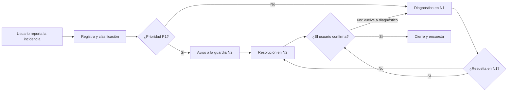

# Demo 2 · Solución esperada

Sirve para `incidencias.pdf` e `incidencias.docx`: los dos tienen el mismo contenido.
Si los regeneras, usa `uv run documentos/generar.py`.

## Orden de lectura de las columnas

Los apartados deben aparecer en este orden: **§1 → §2 → §3 → §4 → §5 → §6 → §7 → §8**.

En el PDF, §1–§4 están en la página 1 y §5–§8 en la página 2. Algunos párrafos
saltan de la columna izquierda a la derecha o a la página siguiente:

- §4 termina en la columna izquierda de la página 2 con «…quedan anotadas con su justificación».
- §6 termina en la columna derecha de la página 2: «El reloj de la incidencia no se detiene mientras se / espera al proveedor…».

La lectura es incorrecta si se mezclan líneas de las dos columnas en la misma frase,
o si un párrafo partido aparece separado de su continuación.

## Resumen del diagrama (figura 1, solo en la imagen)

El texto del documento no describe la figura, así que estos datos solo pueden
salir de la imagen:

1. El usuario reporta la incidencia; se registra y se clasifica.
2. Si es **P1**, se avisa a la guardia N2 y se resuelve en N2.
3. Si no lo es, se diagnostica en N1. Si N1 la resuelve, pasa a confirmación; si no, va a resolución en N2.
4. El usuario confirma la solución: **sí** → cierre y encuesta; **no** → vuelve al diagnóstico en N1.

## Diagrama en Mermaid

## Tablas

**Tabla 1 · Prioridades y tiempos comprometidos**

| Prioridad | Ejemplo | Primera respuesta | Resolución objetivo |
|---|---|---|---|
| P1 · Crítica | Caída del ERP para toda la sede | 15 min | 4 h |
| P2 · Alta | Un departamento sin correo | 1 h | 8 h |
| P3 · Media | Impresora de planta averiada | 4 h | 3 días |
| P4 · Baja | Cambio de fondo de escritorio | 1 día | 10 días |

**Tabla 2 · Matriz de escalado**

| Nivel | Equipo | Cuándo escalar | Canal |
|---|---|---|---|
| N1 | Centro de atención | Entrada de toda incidencia | Portal / teléfono |
| N2 | Sistemas | Servidores, almacenamiento, copias | Cola «N2-SIS» |
| N2 | Redes | Conectividad, VPN, wifi | Cola «N2-RED» |
| N2 | Aplicaciones | Errores funcionales del ERP o CRM | Cola «N2-APP» |
| Guardia | N2 de guardia | Cualquier P1, 24×7 | Teléfono de guardia |

**Tabla 3 · Indicadores del primer trimestre**

| Indicador | Enero | Febrero | Marzo | Objetivo |
|---|---|---|---|---|
| Incidencias recibidas | 412 | 389 | 455 | — |
| Resueltas en N1 | 68 % | 71 % | 74 % | ≥ 70 % |
| P1 en plazo | 92 % | 100 % | 96 % | ≥ 95 % |
| Satisfacción media | 4,1 | 4,3 | 4,2 | ≥ 4,0 |

## Comprobaciones rápidas

- **Tabla 3:** en marzo, «Resueltas en N1» = **74 %**; en enero no llega al objetivo (68 % < 70 %).
- **Tabla 2:** la guardia atiende **cualquier P1, 24×7**.
- **Diagrama:** la rama «No» de «¿El usuario confirma?» vuelve a **Diagnóstico en N1**, no a N2.
