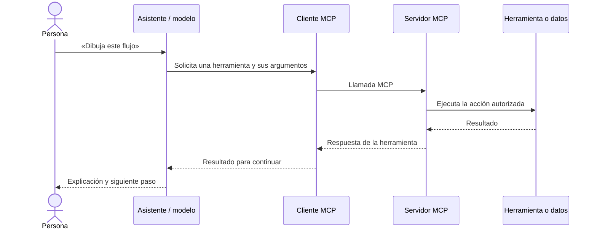

<div class="cover-kicker">TALLER PRÁCTICO · MCP</div>

# MCP en acción

## Algunos MCP útiles 

**Diagramas editables · documentos a Markdown · visión artificial con Chrome**

<div class="cover-footer">Una sesión para entenderlo, configurarlo y probarlo</div>

<!--
Abre con la promesa: no es una charla sobre teoría de modelos. Vamos a conectar un asistente a tres capacidades concretas y a observar qué puede y qué no puede hacer.
-->

---

# Hoy salimos con tres superpoderes

<div class="grid grid-cols-3 gap-5 mt-10">
  <div class="panel panel-cyan"><div class="number">01</div><h3>Dibujar</h3><p>Pasar de una descripción a un diagrama <strong>editable</strong> en draw.io.</p></div>
  <div class="panel panel-violet"><div class="number">02</div><h3>Leer</h3><p>Extraer DOCX y PDF a Markdown con el MCP local de <strong>2MD</strong>.</p></div>
  <div class="panel panel-lime"><div class="number">03</div><h3>Ver</h3><p>Inspección visual en Chrome, pedir acciones y analizar capturas con visión.</p></div>
</div>

<p class="mt-10 text-center opacity-75">Formato: entender → configurar → probar → revisar el resultado</p>

---
layout: section
---

# Antes de empezar

## La IA no adivina tus herramientas: le damos conexiones con límites claros.

---

# MCP, explicado sin siglas

**Model Context Protocol** es un protocolo abierto para conectar asistentes con
herramientas y fuentes de contexto de forma estandarizada. El modelo recibe la
lista de herramientas disponibles y **decide por sí mismo cuándo necesita una**.

<div class="grid grid-cols-3 gap-4 mt-8">
  <div class="panel"><div class="number">01</div><h3>El host</h3><p>La aplicación del asistente que usas.</p><p class="text-sm opacity-75"><strong>Ej.:</strong> OpenCode, Claude Desktop, VS Code.</p></div>
  <div class="panel"><div class="number">02</div><h3>El cliente</h3><p>Gestiona la conexión MCP desde el host.</p><p class="text-sm opacity-75"><strong>Ej.:</strong> la pieza de OpenCode que lanza <code>npx @drawio/mcp</code> y habla con él; una por servidor.</p></div>
  <div class="panel"><div class="number">03</div><h3>El servidor</h3><p>Publica herramientas y recursos que el cliente puede descubrir.</p><p class="text-sm opacity-75"><strong>Ej.:</strong> draw.io MCP, 2MD o una calculadora que publica <code>raiz_cuadrada</code>.</p></div>
</div>

<p class="mt-6"><strong>Ejemplo:</strong> un LLM no sabe calcular una raíz cuadrada; predice texto y puede «inventar» decimales. Si le conectamos una calculadora por MCP, al ver la pregunta <em>se da cuenta</em> de que necesita la tool <code>raiz_cuadrada</code>, la invoca y devuelve √2 = 1,41421356… sin error. MCP no hace más listo al modelo: le da herramientas.</p>

---

# ¿Qué pasa cuando le pides algo?



<div class="grid grid-cols-2 gap-6 mt-4">
<div><strong>El modelo decide</strong><br>qué herramienta usar según la petición y el contexto.</div>
<div><strong>El servidor hace</strong><br>lo que permite su implementación y configuración.</div>
</div>

---

# Tres palabras que conviene distinguir

<div class="grid grid-cols-3 gap-5 mt-10">
  <div class="panel panel-cyan"><h3>Tools</h3><p>Acciones que <strong>el modelo decide</strong> invocar.</p><p class="text-sm opacity-75"><strong>Ej.:</strong> <code>leer_documento</code> de 2MD, <code>open_drawio_mermaid</code> de draw.io, <code>take_screenshot</code> de Chrome o la <code>raiz_cuadrada</code> de la calculadora.</p></div>
  <div class="panel panel-violet"><h3>Resources</h3><p>Contenido que el servidor expone para que el cliente lo lea, con una URI.</p><p class="text-sm opacity-75"><strong>Ej.:</strong> las imágenes que 2MD extrae de un PDF, en <code>2md://images/…</code>, para que un modelo con visión pueda verlas.</p></div>
  <div class="panel panel-lime"><h3>Prompts</h3><p>Plantillas reutilizables que <strong>eliges tú</strong> para guiar una tarea.</p><p class="text-sm opacity-75"><strong>Ej.:</strong> un servidor de incidencias podría ofrecer «Resume esta incidencia», que aparece en el cliente como un comando <code>/</code>.</p></div>
</div>

<p class="mt-8 opacity-75">Cada servidor decide qué ofrece. Un cliente puede mostrar solo parte de esas capacidades.</p>

---

# Un MCP local también cruza fronteras

Que el servidor corra en tu equipo **no significa** que los datos se queden en tu equipo.

- **Cliente ↔ servidor:** un servidor local suele comunicarse por `stdio`; no abre puertos ni publica una web.<br><span class="text-sm opacity-75">Ej.: OpenCode lanza 2MD como proceso hijo y le habla por la entrada/salida estándar.</span>
- **Host ↔ proveedor del modelo:** si el modelo está en la nube, lo que devuelve la tool viaja a ese servicio junto con tu petición.<br><span class="text-sm opacity-75">Ej.: 2MD convierte el PDF en local, pero el Markdown resultante se envía al LLM; una captura de Chrome, también.</span>
- **Servidor ↔ sistema:** el servidor puede hacer todo lo que permitan tu usuario, su configuración y las autorizaciones que concedas.<br><span class="text-sm opacity-75">Ej.: con <code>--autoConnect</code>, el MCP de Chrome DevTools actúa en tu navegador real, con tus sesiones iniciadas.</span>

<div class="callout mt-7"><strong>Regla práctica:</strong> antes de conectar, pregunta qué contenido verá el modelo, qué puede modificar el servidor y qué datos se envían fuera del equipo.</div>

---

# Consideraciones de seguridad

<div class="grid grid-cols-2 gap-6 mt-6">
<div class="panel">

**Instalar un MCP es ejecutar código de un tercero**

- Corre con **tus permisos**: lee ficheros, abre conexiones y lanza procesos.
- `npx -y paquete@latest` descarga y ejecuta **la última versión** sin preguntar: puede cambiar mañana.
- El texto que devuelve llega al modelo: un documento o una web pueden **inyectar instrucciones**.
- Nombre conocido ≠ autor fiable: comprueba **quién lo publica**, el repositorio y su mantenimiento.

</div>
<div class="panel panel-violet">

**Ejemplo: 2MD y su motor Xberg**

- El binario de Xberg **sí puede** usar la red: descarga URLs, sigue enlaces y modelos, y llama a LLM.
- Se **analizó con IA** el código de Xberg para localizar todo lo que puede abrir conexiones.
- 2MD desactiva cada vía de forma explícita y fija la librería con una **copia local y su SHA-512**.
- Los tests comprueban que la conversión abre **0 conexiones**, incluso sin interfaz de red.

<p class="text-sm opacity-75 mt-2">Detalle: <code>docs/security.md</code> en github.com/davidpoza/2md</p>

</div>
</div>

<div class="callout mt-5"><strong>Antes de instalar:</strong> ¿quién está detrás?, ¿qué versión exacta ejecuto?, ¿qué puede tocar? y ¿alguien ha comprobado a dónde se conecta?</div>

---
layout: section
---

# 01 · Diagramas

## De la idea a un draw.io que puedes seguir editando

---

# El caso: un flujo que todo el equipo entienda

<div class="grid grid-cols-2 gap-8 mt-8">
<div>

**Petición de ejemplo**

> Dibuja el recorrido de una solicitud: una persona completa un formulario; la aplicación valida los datos, los guarda y muestra una confirmación. Si falla la validación, vuelve al formulario con errores.

</div>
<div class="panel panel-cyan">

**Lo que queremos obtener**

- Cajas y flechas, no una imagen plana.
- Flujo normal y alternativa de error.
- Etiquetas fáciles de revisar.
- Un diagrama que podamos abrir y corregir en draw.io.

</div>
</div>

<p class="mt-8"><strong>Idea:</strong> describe actores, pasos, decisiones y excepciones. El diseño visual puede iterarse después.</p>

---

# draw.io MCP: descríbelo y retócalo

El servidor publicado como **`@drawio/mcp`** permite entregar diagramas al editor
de draw.io. Entre sus herramientas hay opciones para abrir diagramas XML, Mermaid
y CSV; la salida puede seguir siendo editable.

<div class="grid grid-cols-2 gap-6 mt-7">
<div class="panel">

**Conectar en OpenCode (`opencode.json`)**

```json
{
  "$schema": "https://opencode.ai/config.json",
  "mcp": {
    "servers": {
      "drawio": {
        "type": "local",
        "command": ["npx", "-y", "@drawio/mcp"]
      }
    }
  }
}
```

</div>
<div class="panel panel-cyan">

**Durante la demo**

1. Comprueba que el cliente descubre el servidor.
2. Pide un flujo con camino feliz y error.
3. Revisa el diagrama que se abre en draw.io.

Va en `opencode.json` del proyecto o en `~/.config/opencode/opencode.json` para todos.

</div>
</div>

---
zoom: 0.85
---

# draw.io MCP desde el repo clonado

Alternativa a `npx`: ejecutar el código del repositorio oficial que has descargado y revisado.

<div class="grid grid-cols-2 gap-6 mt-5">
<div class="panel">

**1 · Preparar el clon (una vez)**

```bash
git clone https://github.com/jgraph/drawio-mcp.git
cd drawio-mcp/mcp-tool-server
npm install
npm run copy-shared
```

`copy-shared` copia a `src/` los módulos de `shared/`; sin él, el servidor falla al usar Mermaid o buscar formas.

</div>
<div class="panel panel-cyan">

**2 · Conectar en OpenCode (`opencode.json`)**

```json
{
  "$schema": "https://opencode.ai/config.json",
  "mcp": {
    "servers": {
      "drawio": {
        "type": "local",
        "command": ["node", "C:\\ruta\\a\\drawio-mcp\\mcp-tool-server\\src\\index.js"]
      }
    }
  }
}
```

Usa `node` directamente, no `npm start`: npm escribe en la salida estándar y rompe la comunicación por `stdio`.

</div>
</div>

<div class="callout mt-4"><strong>Ventaja:</strong> la versión no cambia sola como con <code>npx -y</code>; actualizas con <code>git pull</code> cuando lo decides y vuelves a ejecutar <code>npm install</code> y <code>npm run copy-shared</code>.</div>

---

# Algunas tools del MCP de draw.io

| Tool | Qué hace |
|---|---|
| `open_drawio_mermaid` | Convierte Mermaid en un diagrama editable y lo abre en draw.io. **La que usamos en la demo.** |
| `open_drawio_xml` | Abre un diagrama descrito en XML nativo de draw.io: control total de formas y estilos. |
| `open_drawio_csv` | Genera el diagrama a partir de datos tabulares, como un organigrama. |
| `search_shapes` | Busca formas e iconos en las bibliotecas de draw.io (AWS, Azure, redes…). |
| `list_pages` · `get_page` · `set_page` | Leen y modifican páginas de un fichero `.drawio` local. |

---
zoom: 0.88
---

# Mermaid o draw.io: ¿cuándo usar cada uno?

<div class="grid grid-cols-2 gap-6 mt-5">
<div class="panel panel-violet">

### Mermaid

**Ventajas**
- El diagrama es texto: fácil de escribir, versionar y revisar en Git.
- Muy rápido para flujos sencillos, secuencias, clases y relaciones.
- Encaja bien en documentación Markdown.

**Desventajas**
- Menos control sobre la posición exacta y el acabado visual.
- Los diagramas grandes o con requisitos visuales complejos pueden ser difíciles de ajustar.

</div>
<div class="panel panel-cyan">

### draw.io

**Ventajas**
- Edición visual precisa, formas, estilos y bibliotecas de iconos.
- Cómodo para arquitectura, presentaciones y diagramas que requieren pulido manual.
- El resultado se puede seguir editando en el editor.

**Desventajas**
- El XML es más verboso y menos cómodo de revisar o fusionar en Git.
- A menudo hace falta retocar la distribución que genera el modelo.

</div>
</div>

<div class="callout mt-5"><strong>También se pueden combinar:</strong> genera Mermaid para iterar rápido y usa <code>open_drawio_mermaid</code> para abrirlo como un diagrama editable en draw.io.</div>

---

# Demo 1 · Del prompt al diagrama

**Prompt exacto usado para generar el diagrama:**

```text
Usa el MCP de draw.io para dibujar el flujo de una solicitud de vacaciones en tres carriles: Empleado, Sistema y Responsable. El empleado rellena el formulario; el sistema comprueba que esté completo y, si no lo está, lo devuelve con el error; el responsable aprueba o rechaza, y el sistema notifica el resultado al empleado.
```

<div class="grid grid-cols-3 gap-5 mt-6">
  <div class="panel panel-cyan !min-h-0"><div class="number">CARRILES</div><p>¿Están <em>Empleado</em>, <em>Sistema</em> y <em>Responsable</em>, cada paso en el suyo?</p></div>
  <div class="panel panel-violet !min-h-0"><div class="number">DECISIONES</div><p>¿Aparecen las dos decisiones y el retorno al formulario?</p></div>
  <div class="panel panel-lime !min-h-0"><div class="number">RAMAS</div><p>¿Cada salida está etiquetada: <em>Completa / Incompleta</em>, <em>Aprueba / Rechaza</em>?</p></div>
</div>

<style>
pre, pre code { white-space: pre-wrap !important; word-break: break-word; }
</style>

<!--
Este es el prompt exacto usado para generar el diagrama (copia en diagramas/demo1-prompt.md). Pégalo tal cual, sin añadir nada; lánzalo y, cuando se abra draw.io, repasa con el público las tres comprobaciones.

Plan B si el servidor no responde: pide que use open_drawio_mermaid con el contenido de diagramas/demo1.mmd, o abre directamente diagramas/demo1.drawio.
-->

---

# Demo 1 · Resultado

<div class="diagram"></div>

<p class="mt-5"><strong>Generado con el prompt exacto de la diapositiva anterior</strong> (<code>diagramas/demo1-prompt.md</code>) mediante <code>open_drawio_mermaid</code> + ELK. <strong>Comprobación:</strong> tres carriles, dos decisiones etiquetadas y el retorno al formulario.</p>

---
layout: section
---

# 02 · Documentos

## Word y PDF a Markdown con el MCP local de 2MD

---

# Por qué usar el MCP de 2MD

<div class="grid grid-cols-2 gap-5 mt-8">
  <div class="panel panel-cyan !min-h-0"><div class="number">01</div><h3>Totalmente local</h3><p>La conversión a Markdown se hace en tu equipo; el documento no se sube a ningún servicio para extraerlo.</p></div>
  <div class="panel panel-violet !min-h-0"><div class="number">02</div><h3>Sin límite de tamaño ni de ficheros</h3><p>No hay tope de páginas, de megas ni de documentos por conversación.</p></div>
  <div class="panel panel-lime !min-h-0"><div class="number">03</div><h3>Sin indexar</h3><p>A diferencia de AIOperator, no hace falta indexar antes: se pide el documento y se lee al momento.</p></div>
  <div class="panel !min-h-0"><div class="number">04</div><h3>Ve las imágenes</h3><p>Con un modelo multimodal, el asistente puede interpretar las imágenes extraídas, por ejemplo un diagrama.</p></div>
</div>

---

# Qué expone el MCP de 2MD: una tool y recursos

2MD expone **una sola tool** y sirve las imágenes como **recursos MCP**.

| Tool / recurso | Qué hace |
|---|---|
| `leer_documento(ruta)` | Convierte un PDF o DOCX del directorio permitido, sin IA ni OCR. Devuelve `markdown`, `archivo_markdown`, `advertencias` e `imagenes`. |
| `resources/list` | Lista las imágenes extraídas, con URIs del tipo `2md://images/…`. |
| `resources/read` | Entrega una imagen para que un modelo multimodal pueda verla. |

<div class="callout mt-6">En el Markdown, los enlaces a imágenes ya apuntan a <code>2md://images/…</code>. Si el cliente no admite recursos MCP, el modelo recibe el texto, pero no ve el diagrama.</div>

---

# Configuración en OpenCode · `opencode.json`

```json
{
  "$schema": "https://opencode.ai/config.json",
  "mcp": {
    "servers": {
      "2md": {
        "type": "local",
        "command": ["C:\\ruta\\a\\2MD\\2MD-MCP.exe"],
        "timeout": { "execution": 600000 }
      }
    }
  }
}
```

- En OpenCode, los servidores van en `mcp.servers` y `command` es una lista: el ejecutable y sus argumentos.
- `timeout.execution` va en milisegundos: 600000 son 10 minutos para documentos grandes.
- Comprueba con `opencode mcp list` que **2md** aparece conectado y, en la sesión, que está la tool **`leer_documento`**.
- La ruta del documento se resuelve respecto al directorio permitido si es relativa.

---

# Demo 2 · A · PDF: columnas, tablas y un diagrama

**Prompt exacto:**

```text
Usa leer_documento para leer incidencias.pdf. Después:
1. Resume en cinco líneas lo que muestra la figura 1, mirando la imagen extraída y no el texto.
2. Genera un Markdown con las tres tablas del documento y con el diagrama de la figura 1 en Mermaid.
3. Verifica el orden de lectura de las columnas: lista los apartados §1 a §8 en el orden en que aparecen en la extracción y señala cualquier frase que mezcle las dos columnas.
Si algo no se ha podido extraer, dilo en lugar de suponerlo.
```

<p class="mt-4 opacity-75">4 páginas: texto a dos columnas con párrafos partidos entre columnas y páginas, 3 tablas y el flujo de la figura 1 como imagen. El texto no describe la figura: solo se puede resumir mirándola.</p>

<style>
pre, pre code { white-space: pre-wrap !important; word-break: break-word; }
</style>

<!--
Copia documentos/incidencias.pdf al directorio permitido de 2MD antes de la sesión. Pega el prompt tal cual.
Compara la respuesta con documentos/solucion-esperada.md.
-->

---

# Demo 2 · B · Word: columnas, tablas y un diagrama

**Prompt exacto:**

```text
Usa leer_documento para leer incidencias.docx. Después:
1. Resume en cinco líneas lo que muestra la figura 1, mirando la imagen extraída y no el texto.
2. Genera un Markdown con las tres tablas del documento y con el diagrama de la figura 1 en Mermaid.
3. Verifica el orden de lectura de las columnas: lista los apartados §1 a §8 en el orden en que aparecen en la extracción y señala cualquier frase que mezcle las dos columnas.
Si algo no se ha podido extraer, dilo en lugar de suponerlo.
```

<p class="mt-4 opacity-75">El mismo contenido en DOCX, con una sección de Word a dos columnas, tablas nativas y la figura incrustada. Mismo prompt; solo cambia el fichero.</p>

<style>
pre, pre code { white-space: pre-wrap !important; word-break: break-word; }
</style>

<!--
Copia documentos/incidencias.docx al directorio permitido de 2MD antes de la sesión. Pega el prompt tal cual.
Compara la respuesta con documentos/solucion-esperada.md.
-->

---

# Demo 2 · Cómo comprobar el resultado

<div class="grid grid-cols-3 gap-5 mt-8">
  <div class="panel panel-cyan !min-h-0"><div class="number">COLUMNAS</div><p>¿Salen §1 → §8 en orden? En el PDF, §6 salta de columna a media frase: «…no se detiene mientras se / espera al proveedor».</p></div>
  <div class="panel panel-violet !min-h-0"><div class="number">TABLAS</div><p>Comprueba una celda: en marzo, <em>Resueltas en N1</em> = <strong>74 %</strong>; la guardia atiende <em>cualquier P1, 24×7</em>.</p></div>
  <div class="panel panel-lime !min-h-0"><div class="number">DIAGRAMA</div><p>Si el usuario no confirma, ¿vuelve a <strong>Diagnóstico en N1</strong>? Pega el Mermaid en draw.io o en un visor y compáralo con la figura.</p></div>
</div>

<div class="callout mt-6">Solución completa: <code>documentos/solucion-esperada.md</code>. Compara las dos demos: ¿se lee igual el PDF que el Word?</div>

---
layout: section
---

# 03 · Pruebas visuales

## Chrome DevTools MCP + visión artificial

---

# El agente mira la misma interfaz que tú

<div class="grid grid-cols-3 gap-5 mt-9">
  <div class="panel panel-cyan"><div class="number">1</div><h3>Chrome</h3><p>Abre la web real, por ejemplo Ryanair, en un perfil de prueba.</p></div>
  <div class="panel panel-violet"><div class="number">2</div><h3>DevTools MCP</h3><p>Permite navegar, inspeccionar, interactuar y tomar capturas.</p></div>
  <div class="panel panel-lime"><div class="number">3</div><h3>Modelo con visión</h3><p>Interpreta las capturas y ayuda a describir lo que ve.</p></div>
</div>

<div class="callout mt-8"><strong>Importante:</strong> el modelo no controla Chrome por sí solo. MCP aporta las herramientas; el cliente y el modelo deciden cómo utilizarlas.</div>

---
zoom: 0.85
---

# Algunas tools del MCP de Chrome DevTools

| Tool | Qué hace |
|---|---|
| `navigate_page` · `new_page` | Abre una URL o una pestaña nueva. |
| `take_snapshot` | Devuelve el árbol de accesibilidad de la página con un identificador por elemento. |
| `take_screenshot` | Captura la página o un elemento para que el modelo la analice con visión. |
| `click` · `fill` · `fill_form` · `press_key` | Interactúan con los elementos identificados en el snapshot. |
| `wait_for` | Espera a que aparezca un texto antes de seguir. |
| `list_console_messages` · `list_network_requests` | Revisan errores de consola y peticiones de red. |
| `lighthouse_audit` · `performance_start_trace` | Auditan la accesibilidad y el rendimiento. |

---

# Conecta Chrome de forma explícita

**Opción recomendada: Chrome 144+ con conexión autorizada**

1. En Chrome, abre `chrome://inspect/#remote-debugging`.
2. Habilita **Remote Debugging** y confirma que permites conexiones.
3. Registra el servidor en `opencode.json`:

```json
{
  "$schema": "https://opencode.ai/config.json",
  "mcp": {
    "servers": {
      "chrome-devtools": {
        "type": "local",
        "command": ["npx", "-y", "chrome-devtools-mcp@latest", "--autoConnect"]
      }
    }
  }
}
```

4. Cuando Chrome pregunte, revisa y acepta la conexión. Verás el indicador de automatización mientras esté activa.

---

# Demo 3 · ¿Por qué tarda en cargar?

**Prompt exacto:**

```text
Usando el mcp chrome devtools, analiza el rendimiento de carga de https://empresas.aena.es/empresas-home/ y dame la recomendación que más lo mejoraría, con los datos que la justifican
```

<div class="grid grid-cols-3 gap-5 mt-6">
  <div class="panel panel-cyan !min-h-0"><div class="number">TOOLS</div><p>¿Graba una traza con <code>performance_start_trace</code> recargando la página? ¿Profundiza con <code>performance_analyze_insight</code>?</p></div>
  <div class="panel panel-violet !min-h-0"><div class="number">CRITERIO</div><p>¿Cita métricas reales (LCP, CLS, TTFB) y el recurso culpable, o da consejos genéricos de «optimiza las imágenes»?</p></div>
  <div class="panel panel-lime !min-h-0"><div class="number">VERIFICA</div><p>Graba tú la misma traza en el panel <strong>Performance</strong> de DevTools. ¿Coinciden las cifras y el diagnóstico?</p></div>
</div>

<style>
pre, pre code { white-space: pre-wrap !important; word-break: break-word; }
</style>

<!--
Pega el prompt tal cual. Aquí no hace falta interactuar con la página: el valor está en que el modelo lea la traza y la convierta en una recomendación priorizada.
Las cifras varían con la red, la caché y la máquina: el resultado se valida repitiendo la traza en DevTools, no comparándolo con una solución fija.
-->

---

# Demo 4 · Buscar el vuelo más barato en Ryanair

**Prompt exacto:**

```text
Usando el mcp chrome devtools, navega a la web de Ryanair, y dame el precio más barato para un viaje
De Reus (Barcelona) a Düsseldorf Weeze
fechas flexibles
para 2 adultos en Mayo de 5 a 10 noches
```

<div class="grid grid-cols-3 gap-5 mt-6">
  <div class="panel panel-cyan !min-h-0"><div class="number">TOOLS</div><p>¿Qué usa para orientarse: <code>take_snapshot</code> o <code>take_screenshot</code>? ¿Cómo resuelve las cookies y el calendario?</p></div>
  <div class="panel panel-violet !min-h-0"><div class="number">CRITERIO</div><p>¿Respeta 2 adultos, mayo y estancias de 5 a 10 noches? ¿Explica cómo ha comparado las fechas?</p></div>
  <div class="panel panel-lime !min-h-0"><div class="number">VERIFICA</div><p>Comprueba en la pantalla el precio y las fechas que da. ¿Se detiene antes de reservar o pagar?</p></div>
</div>

<style>
pre, pre code { white-space: pre-wrap !important; word-break: break-word; }
</style>

<!--
Pega el prompt tal cual. Usa un perfil de Chrome limpio, sin sesión de Ryanair.
Los precios cambian: no hay solución fija, el resultado se valida mirando la propia web.
-->

---
zoom: 0.72
---

# Demo 4 · Resultado

<div class="grid grid-cols-2 gap-6 mt-2">
<div>
  
</div>
<div>

**Cómo llegó: 71 llamadas a tools**

1. Prueba dos URLs inventadas del buscador: «Page not found». Vuelve a la portada.
2. Rellena origen y destino como una persona: `fill_form`, `click` y `press_key`.
3. **El slider de noches se le resiste**: unas 20 llamadas con `evaluate_script` y flechas del teclado hasta dejarlo en «5 a 10 noches».
4. Pone 2 adultos, busca y carga los 7 resultados.
5. Abre el más barato en otra pestaña para ver el desglose: 165,98 € × 2.

**Para comentar**

- **Coste: unos 4 millones de tokens, sin usar visión**: en cada una de las 71 llamadas se reenvía todo el contexto acumulado.
- Se orientó con `take_snapshot` y su propio JavaScript: **ninguna captura de pantalla**.
- **Supuso el año**: mayo de 2027. Hay que revisarlo.

</div>
</div>

---

# Demo 5 · Ahora sí hace falta mirar

**Prompt exacto:**

```text
Usando el mcp chrome devtools, responde si o no, en esta url ves a un colega tuyo? https://imgur.com/a/YGOJmae
```

<div class="grid grid-cols-2 gap-6 mt-4">
<div>
  
</div>
<div>

- **Sin pistas:** el título y la descripción de la página solo dicen «imgur.com». En texto no hay nada que responda.
- **Tools:** ¿llama a `take_screenshot`? Si solo usa `take_snapshot`, está adivinando.
- **Interpreta:** no basta con describir; tiene que reconocer qué hay y relacionarlo con «colega tuyo». ¿Responde solo sí o no?

</div>
</div>

<div class="callout mt-4">Contraste con la demo 4: allí el árbol de accesibilidad bastaba. Aquí la respuesta solo está en los píxeles.</div>

<style>
pre, pre code { white-space: pre-wrap !important; word-break: break-word; }
</style>

<!--
Respuesta esperada: «Sí». La imagen es el endoesqueleto metálico de Terminator: un robot, «colega» de una IA.
Si el modelo responde sin take_screenshot, pregúntale en qué se basa.
-->

