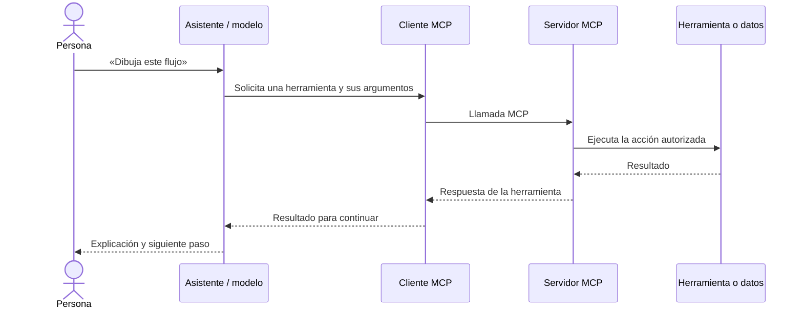

<div class="cover-kicker">TALLER PRÁCTICO · IA PARA EL TRABAJO REAL</div>

# MCP en acción

## De pedir ayuda a conectar herramientas

**Diagramas editables · documentos a Markdown · pruebas visuales en MOISES**

<div class="cover-footer">Una sesión para entenderlo, configurarlo y probarlo</div>

<!--
Abre con la promesa: no es una charla sobre teoría de modelos. Vamos a conectar un asistente a tres capacidades concretas y a observar qué puede y qué no puede hacer.
-->

---

# Hoy salimos con tres superpoderes

<div class="grid grid-cols-3 gap-5 mt-10">
  <div class="panel panel-cyan"><div class="number">01</div><h3>Dibujar</h3><p>Pasar de una descripción a un diagrama <strong>editable</strong> en draw.io.</p></div>
  <div class="panel panel-violet"><div class="number">02</div><h3>Leer</h3><p>Extraer DOCX y PDF a Markdown con el MCP local de <strong>2MD</strong>.</p></div>
  <div class="panel panel-lime"><div class="number">03</div><h3>Probar</h3><p>Inspeccionar MOISES en Chrome, pedir acciones y analizar capturas con visión.</p></div>
</div>

<p class="mt-10 text-center opacity-75">Formato: entender → configurar → probar → revisar el resultado</p>

---
layout: section
---

# Antes de empezar

## La IA no adivina tus herramientas: le damos conexiones con límites claros.

---

# MCP, explicado sin siglas

**Model Context Protocol** es un protocolo abierto para conectar asistentes con
herramientas y fuentes de contexto de forma estandarizada.

<div class="grid grid-cols-3 gap-4 mt-8">
  <div class="panel"><div class="number">01</div><h3>El host</h3><p>La aplicación del asistente que usas.</p></div>
  <div class="panel"><div class="number">02</div><h3>El cliente</h3><p>Gestiona la conexión MCP desde el host.</p></div>
  <div class="panel"><div class="number">03</div><h3>El servidor</h3><p>Publica herramientas y recursos que el cliente puede descubrir.</p></div>
</div>

<p class="mt-6"><strong>Analogía:</strong> un conector común entre asistentes y herramientas; no es el modelo, ni una IA nueva, ni una garantía de que todo cliente lo soporte igual.</p>

---

# ¿Qué pasa cuando le pides algo?



<div class="grid grid-cols-2 gap-6 mt-4">
<div><strong>El modelo decide</strong><br>qué herramienta usar según la petición y el contexto.</div>
<div><strong>El servidor hace</strong><br>lo que permite su implementación y configuración.</div>
</div>

---

# Tres palabras que conviene distinguir

<div class="grid grid-cols-3 gap-5 mt-10">
  <div class="panel panel-cyan"><h3>Tools</h3><p>Acciones invocables:<br><code>leer_documento</code>, abrir un diagrama, tomar una captura.</p></div>
  <div class="panel panel-violet"><h3>Resources</h3><p>Contenido accesible al cliente, por ejemplo imágenes extraídas por 2MD.</p></div>
  <div class="panel panel-lime"><h3>Prompts</h3><p>Plantillas reutilizables para guiar una tarea.</p></div>
</div>

<p class="mt-8 opacity-75">Cada servidor decide qué ofrece. Un cliente puede mostrar solo parte de esas capacidades.</p>

---

# Un MCP local también cruza fronteras

- **Cliente ↔ servidor:** un servidor local suele comunicarse por `stdio`; no necesita publicar una web.
- **Modelo ↔ proveedor:** la petición, los fragmentos de documento o la captura pueden viajar al servicio de IA, según el cliente y la configuración.
- **Servidor ↔ aplicaciones:** los permisos efectivos dependen del sistema operativo, la configuración y las autorizaciones.

<div class="callout mt-7"><strong>Regla práctica:</strong> antes de conectar, pregunta qué contenido verá el modelo, qué puede modificar el servidor y qué datos se envían fuera del equipo.</div>

---
layout: section
---

# 01 · Diagramas

## De la idea a un draw.io que puedes seguir editando

---

# El caso: un flujo que todo el equipo entienda

<div class="grid grid-cols-2 gap-8 mt-8">
<div>

**Petición de ejemplo**

> Dibuja el recorrido de una solicitud: una persona completa un formulario; la aplicación valida los datos, los guarda y muestra una confirmación. Si falla la validación, vuelve al formulario con errores.

</div>
<div class="panel panel-cyan">

**Lo que queremos obtener**

- Cajas y flechas, no una imagen plana.
- Flujo normal y alternativa de error.
- Etiquetas fáciles de revisar.
- Un diagrama que podamos abrir y corregir en draw.io.

</div>
</div>

<p class="mt-8"><strong>Idea:</strong> describe actores, pasos, decisiones y excepciones. El diseño visual puede iterarse después.</p>

---

# draw.io MCP: descríbelo y retócalo

El servidor publicado como **`@drawio/mcp`** permite entregar diagramas al editor
de draw.io. Entre sus herramientas hay opciones para abrir diagramas XML, Mermaid
y CSV; la salida puede seguir siendo editable.

<div class="grid grid-cols-2 gap-6 mt-7">
<div class="panel">

**Conectar (ejemplo `mcpServers`)**

```json
{
  "mcpServers": {
    "drawio": {
      "command": "npx",
      "args": ["-y", "@drawio/mcp"]
    }
  }
}
```

</div>
<div class="panel panel-cyan">

**Durante la demo**

1. Comprueba que el cliente descubre el servidor.
2. Pide un flujo con camino feliz y error.
3. Observa qué herramienta elige.
4. Abre el resultado y corrige un detalle a mano.

La ubicación exacta de la configuración depende del cliente.

</div>
</div>

---

# Mermaid o draw.io: ¿cuándo usar cada uno?

<div class="grid grid-cols-2 gap-6 mt-5">
<div class="panel panel-violet">

### Mermaid

**Ventajas**
- El diagrama es texto: fácil de escribir, versionar y revisar en Git.
- Muy rápido para flujos sencillos, secuencias, clases y relaciones.
- Encaja bien en documentación Markdown.

**Desventajas**
- Menos control sobre la posición exacta y el acabado visual.
- Los diagramas grandes o con requisitos visuales complejos pueden ser difíciles de ajustar.

</div>
<div class="panel panel-cyan">

### draw.io

**Ventajas**
- Edición visual precisa, formas, estilos y bibliotecas de iconos.
- Cómodo para arquitectura, presentaciones y diagramas que requieren pulido manual.
- El resultado se puede seguir editando en el editor.

**Desventajas**
- El XML es más verboso y menos cómodo de revisar o fusionar en Git.
- A menudo hace falta retocar la distribución que genera el modelo.

</div>
</div>

<div class="callout mt-5"><strong>También se pueden combinar:</strong> genera Mermaid para iterar rápido y usa <code>open_drawio_mermaid</code> para abrirlo como un diagrama editable en draw.io.</div>

---

# Demo 1 · Primero estructura; luego pulimos

<div class="prompt">
Usa el MCP de draw.io para dibujar un flujo de solicitud de vacaciones:
empleado → formulario → validación del responsable → aprobación o rechazo →
notificación al empleado. Incluye también la rama de datos incompletos, que
vuelve al formulario. Usa nombres claros y separa las responsabilidades.
</div>

<div class="grid grid-cols-2 gap-6 mt-7">
<div><strong>Pregunta al modelo:</strong><br>«¿Qué herramienta vas a usar y qué datos le vas a pasar?»</div>
<div><strong>Revisa en draw.io:</strong><br>¿se entiende el orden?, ¿faltan ramas?, ¿puedes editar los elementos?</div>
</div>

---

# Un resultado útil no es automáticamente seguro

- El servidor puede ejecutarse localmente, pero el **editor web** puede descargarse desde draw.io.
- Los datos del prompt también siguen la política del proveedor del modelo.
- Una URL de diagrama puede incluir el contenido en el fragmento: no compartas esa URL como si estuviera vacía.
- Si buscas formas o recursos externos, comprueba qué solicitudes salen del equipo.

<p class="mt-6"><strong>Práctica:</strong> empieza con un proceso ficticio; no incluyas arquitectura interna, credenciales ni datos de clientes.</p>

---
layout: section
---

# 02 · Documentos

## Word y PDF a Markdown con el MCP local de 2MD

---

# 2MD: extracción sin enviar el documento a IA

2MD convierte **PDF y DOCX a Markdown localmente**. El MCP local expone
`leer_documento`, que recibe una ruta y devuelve el Markdown, la ruta de salida,
advertencias y las imágenes extraídas.

<div class="grid grid-cols-2 gap-6 mt-7">
<div class="panel panel-violet">

**Qué esperar**

- El documento de origen no se modifica.
- El resultado se organiza en una carpeta por documento.
- Las imágenes extraídas se guardan en `assets`.
- OCR está desactivado: un PDF escaneado puede no producir texto útil.

</div>
<div class="panel">

**Qué no asumir**

- No garantiza fidelidad perfecta en tablas, diagramas u orden de lectura.
- Que el MCP extraiga un archivo no significa que se envíe a un modelo.
- El análisis con IA es opcional y requiere activación y consentimiento.
- El cliente debe admitir los recursos MCP para acceder a las imágenes.

</div>
</div>

---

# Preparación del servidor 2MD

<div class="steps">
  <div><span>1</span><p>Abre 2MD, elige el destino y habilita MCP local.</p></div>
  <div><span>2</span><p>Configura el directorio permitido donde dejarás el documento de prueba.</p></div>
  <div><span>3</span><p>Guarda la configuración y cierra 2MD si ya no necesitas la interfaz.</p></div>
  <div><span>4</span><p>Conecta en el cliente el ejecutable <code>2MD-MCP.exe</code> de la distribución MCP.</p></div>
</div>

<div class="callout mt-5">Copia la distribución completa de MCP; el ejecutable no se distribuye como archivo independiente. Configura la ruta real de Windows en el cliente.</div>

---

# Configuración de ejemplo · cliente con `mcpServers`

```json
{
  "mcpServers": {
    "2md": {
      "command": "C:\\ruta\\a\\2MD\\2MD-MCP.exe",
      "timeout": 600
    }
  }
}
```

- Ejemplo para clientes con estructura `mcpServers`; la interfaz y el formato pueden variar.
- Comprueba que el cliente muestra el servidor **2md** y la herramienta **`leer_documento`**.
- La ruta del documento se resuelve respecto al directorio permitido si es relativa.

---

# Demo 2 · Una lectura comprobable

<div class="prompt">
Usa <code>leer_documento</code> para leer
<code>procedimientos\vacaciones.docx</code>. Resume el objetivo, los pasos
principales y las excepciones. Si hay imágenes o advertencias, indícalo. No
rellenes los huecos con suposiciones: separa lo que dice el documento de lo
que no se ha podido extraer.
</div>

<div class="grid grid-cols-2 gap-6 mt-7">
<div><strong>Comprobación:</strong><br>Compara una frase del Markdown con el documento original.</div>
<div><strong>Pregunta:</strong><br>¿Hay imágenes o una advertencia de PDF escaneado? ¿Qué quedó fuera?</div>
</div>

---

# Extraer no es validar

1. Contrasta el resumen con el original, especialmente tablas y notas.
2. Si el PDF es una imagen escaneada, detente: la extracción actual no hace OCR.
3. Comprueba las imágenes en `assets` y los enlaces del Markdown.
4. No pegues texto confidencial en un chat sin revisar antes las reglas de tu organización.

<p class="mt-6 opacity-75">La conversión normal de 2MD es local. Un paso posterior de IA es otra operación y puede tener otro destino de datos.</p>

---
layout: section
---

# 03 · Pruebas visuales

## Chrome DevTools MCP + visión para explorar MOISES

---

# El agente mira la misma interfaz que tú

<div class="grid grid-cols-3 gap-5 mt-9">
  <div class="panel panel-cyan"><div class="number">1</div><h3>Chrome</h3><p>Presenta MOISES en un navegador de prueba.</p></div>
  <div class="panel panel-violet"><div class="number">2</div><h3>DevTools MCP</h3><p>Permite navegar, inspeccionar, interactuar y tomar capturas.</p></div>
  <div class="panel panel-lime"><div class="number">3</div><h3>Modelo con visión</h3><p>Interpreta las capturas y ayuda a describir lo que ve.</p></div>
</div>

<div class="callout mt-8"><strong>Importante:</strong> el modelo no controla Chrome por sí solo. MCP aporta las herramientas; el cliente y el modelo deciden cómo utilizarlas.</div>

---

# Conecta Chrome de forma explícita

**Opción recomendada: Chrome 144+ con conexión autorizada**

1. En Chrome, abre `chrome://inspect/#remote-debugging`.
2. Habilita **Remote Debugging** y confirma que permites conexiones.
3. Registra el servidor MCP en tu cliente:

```json
{
  "mcpServers": {
    "chrome-devtools": {
      "command": "npx",
      "args": ["-y", "chrome-devtools-mcp@latest", "--autoConnect"]
    }
  }
}
```

4. Cuando Chrome pregunte, revisa y acepta la conexión. Verás el indicador de automatización mientras esté activa.

---

# Si necesitas el puerto de depuración

Inicia una instancia **separada** de Chrome con un perfil desechable y el puerto
habilitado. En Windows, ajusta la ruta de `chrome.exe` a tu instalación:

```powershell
& "$env:ProgramFiles\Google\Chrome\Application\chrome.exe" `
  --remote-debugging-port=9222 `
  --user-data-dir="$env:TEMP\chrome-mcp"
```

Configura el servidor con `--browser-url=http://127.0.0.1:9222`.

<div class="callout mt-5">No habilites depuración sobre un perfil personal: una conexión de depuración puede acceder al contenido del navegador. Usa un perfil limpio y cierra la sesión al terminar.</div>

---

# Demo 3 · Prueba guiada en MOISES

<div class="prompt">
En la instancia de prueba de MOISES que ya está abierta, inspecciona la pantalla
actual y explica qué opciones principales se ven. No envíes formularios ni
modifiques datos. Toma una captura. Después, describe un flujo de prueba seguro
para llegar a la pantalla de búsqueda, indicando en qué momento pedirías
confirmación antes de realizar una acción con efectos.
</div>

<div class="grid grid-cols-2 gap-6 mt-7">
<div><strong>Observa:</strong><br>¿el agente describe elementos visibles y toma la captura correcta?</div>
<div><strong>Controla:</strong><br>¿pide permiso antes de una acción que cambia datos?</div>
</div>

---

# De la inspección a una prueba funcional

Una vez acordado el recorrido, pide **una acción cada vez**:

1. Identificar la pantalla y el estado inicial.
2. Ejecutar el paso inocuo y verificar el resultado visible.
3. Tomar una captura al llegar a un punto de control.
4. Detenerse ante datos personales, cambios persistentes o incertidumbre.

<p class="mt-7"><strong>La captura es evidencia para revisar, no una prueba automática de que el sistema funciona correctamente.</strong> Contrasta los resultados esperados con una persona y un entorno autorizados.</p>

---

# Visión: capacidad y límites

- GLM-5.3-Flash acepta imágenes; un cliente que le entregue capturas puede pedirle describir lo que ve.
- El MCP toma capturas y ofrece acciones de navegador; la visión ayuda a interpretar píxeles.
- Una captura puede estar incompleta, desactualizada o no mostrar un error.
- El modelo puede confundir texto, controles o estados; verifica manualmente lo importante.
- El servidor expone contenido del navegador al cliente MCP. Evita pestañas con datos sensibles.

---
layout: section
---

# Cierre · criterio antes que magia

---

# Lo que hemos conectado

<div class="grid grid-cols-3 gap-5 mt-10">
  <div class="panel panel-cyan"><h3>draw.io</h3><p>Una descripción se convierte en un diagrama que puedes corregir.</p></div>
  <div class="panel panel-violet"><h3>2MD</h3><p>Un documento local se convierte en texto revisable, con advertencias visibles.</p></div>
  <div class="panel panel-lime"><h3>Chrome</h3><p>Una interfaz se puede inspeccionar, probar y capturar bajo supervisión.</p></div>
</div>

<p class="mt-9 text-center text-xl"><strong>MCP conecta capacidades. El criterio humano sigue al mando.</strong></p>

---

# Lista rápida antes de conectar cualquier MCP

- ¿Confío en el servidor y entiendo los permisos que necesita?
- ¿Qué contenido verá el cliente y qué podría llegar al proveedor del modelo?
- ¿Estoy usando una cuenta, carpeta, instancia y datos de prueba?
- ¿Qué acciones podrían modificar información o iniciar una operación real?
- ¿Cómo voy a revisar el resultado y detener el flujo?

<p class="mt-8 text-center opacity-75">Empieza con un ejemplo pequeño, observa cada llamada y amplía permisos solo si hacen falta.</p>

---

# Referencias para seguir explorando

- [Model Context Protocol — documentación oficial](https://modelcontextprotocol.io/)
- [draw.io MCP — artículo práctico y configuración](https://davidinformatico.com/drawio-mcp)
- [2MD — repositorio, README y lógica funcional](https://github.com/davidpoza/2md)
- [Chrome DevTools MCP — repositorio oficial](https://github.com/ChromeDevTools/chrome-devtools-mcp)
- [Chrome DevTools — conexión al navegador y configuración](https://developer.chrome.com/docs/devtools/agents/get-started/configuration)
- [GLM-5.3-Flash — ficha del modelo](https://build.nvidia.com/z-ai/glm-5-3-flash/modelcard)
- [Slidev — guía](https://sli.dev/guide/)

<p class="mt-8 text-center"><strong>¡Gracias! Preguntas y pruebas.</strong></p>

---
layout: end
---

# Menos copiar y pegar.

## Más conectar, observar y verificar.

<div class="end-mark">MCP · DRAW.IO · 2MD · CHROME DEVTOOLS</div>

<style>
:root {
  --slidev-theme-primary: #64f5c2;
}

.slidev-layout {
  background:
    radial-gradient(ellipse at 86% 12%, rgba(84, 74, 190, 0.16), transparent 34%),
    #10131d;
  color: #eef0fa;
}

.slidev-layout.cover,
.slidev-layout.end {
  background:
    radial-gradient(ellipse at 77% 33%, rgba(100, 245, 194, 0.16), transparent 31%),
    radial-gradient(ellipse at 12% 86%, rgba(130, 102, 255, 0.16), transparent 35%),
    #10131d;
}

h1 {
  color: #f7f7ff;
  letter-spacing: -0.035em;
}

h2 {
  color: #b7c3d9;
  font-weight: 500;
}

h3 {
  margin: 0.5rem 0;
  color: #f5f6ff;
  font-size: 1.15rem;
}

strong {
  color: #75f3c4;
}

code {
  color: #9af4d0;
}

.cover-kicker,
.end-mark {
  color: #75f3c4;
  font-size: 0.8rem;
  font-weight: 700;
  letter-spacing: 0.18em;
}

.cover-footer {
  margin-top: 3rem;
  color: #9aa5bc;
  font-size: 0.9rem;
}

.panel {
  min-height: 9rem;
  padding: 1.1rem 1.2rem;
  border: 1px solid rgba(185, 196, 220, 0.18);
  border-radius: 0.8rem;
  background: rgba(255, 255, 255, 0.035);
}

.panel p {
  margin: 0.45rem 0 0;
  color: #c4cadd;
  font-size: 0.93rem;
  line-height: 1.5;
}

.panel-cyan {
  border-color: rgba(82, 215, 240, 0.38);
}

.panel-violet {
  border-color: rgba(172, 137, 255, 0.4);
}

.panel-lime {
  border-color: rgba(168, 233, 104, 0.38);
}

.number {
  color: #75f3c4;
  font-size: 0.82rem;
  font-weight: 700;
  letter-spacing: 0.12em;
}

.callout {
  padding: 0.9rem 1.1rem;
  border-left: 3px solid #75f3c4;
  border-radius: 0 0.5rem 0.5rem 0;
  background: rgba(117, 243, 196, 0.07);
  color: #d7dced;
}

.prompt {
  padding: 1.25rem 1.4rem;
  border: 1px solid rgba(172, 137, 255, 0.4);
  border-radius: 0.8rem;
  background: rgba(172, 137, 255, 0.07);
  color: #f0edff;
  font-size: 1.15rem;
  line-height: 1.65;
}

.steps > div {
  display: flex;
  align-items: baseline;
  gap: 1rem;
  margin: 0.55rem 0;
}

.steps span {
  display: inline-flex;
  width: 1.8rem;
  height: 1.8rem;
  flex: 0 0 1.8rem;
  align-items: center;
  justify-content: center;
  border: 1px solid rgba(117, 243, 196, 0.5);
  border-radius: 999px;
  color: #75f3c4;
  font-weight: 700;
}

.steps p {
  margin: 0;
}

.mermaid {
  background: transparent !important;
}

.mermaid svg {
  max-height: 390px;
}
</style>
