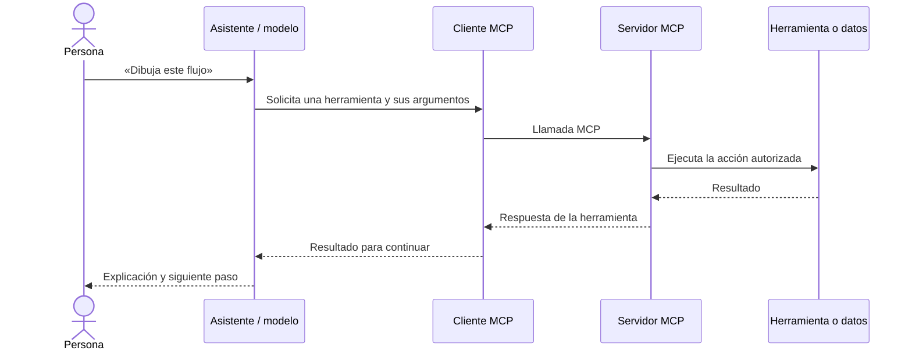

<div class="cover-kicker">TALLER PRÁCTICO · MCP</div>

# MCP en acción

## Algunos MCP útiles 

**Diagramas editables · documentos a Markdown · visión artificial con Chrome**

<div class="cover-footer">Una sesión para entenderlo, configurarlo y probarlo</div>

<!--
Abre con la promesa: no es una charla sobre teoría de modelos. Vamos a conectar un asistente a tres capacidades concretas y a observar qué puede y qué no puede hacer.
-->

---

# Hoy salimos con tres superpoderes

<div class="grid grid-cols-3 gap-5 mt-10">
  <div class="panel panel-cyan"><div class="number">01</div><h3>Dibujar</h3><p>Pasar de una descripción a un diagrama <strong>editable</strong> en draw.io.</p></div>
  <div class="panel panel-violet"><div class="number">02</div><h3>Leer</h3><p>Extraer DOCX y PDF a Markdown con el MCP local de <strong>2MD</strong>.</p></div>
  <div class="panel panel-lime"><div class="number">03</div><h3>Ver</h3><p>Inspección visual en Chrome, pedir acciones y analizar capturas con visión.</p></div>
</div>

<p class="mt-10 text-center opacity-75">Formato: entender → configurar → probar → revisar el resultado</p>

---
layout: section
---

# Antes de empezar

## La IA no adivina tus herramientas: le damos conexiones con límites claros.

---

# MCP, explicado sin siglas

**Model Context Protocol** es un protocolo abierto para conectar asistentes con
herramientas y fuentes de contexto de forma estandarizada.

<div class="grid grid-cols-3 gap-4 mt-8">
  <div class="panel"><div class="number">01</div><h3>El host</h3><p>La aplicación del asistente que usas.</p></div>
  <div class="panel"><div class="number">02</div><h3>El cliente</h3><p>Gestiona la conexión MCP desde el host.</p></div>
  <div class="panel"><div class="number">03</div><h3>El servidor</h3><p>Publica herramientas y recursos que el cliente puede descubrir.</p></div>
</div>

<p class="mt-6"><strong>Analogía:</strong> un conector común entre asistentes y herramientas; no es el modelo, ni una IA nueva, ni una garantía de que todo cliente lo soporte igual.</p>

---

# ¿Qué pasa cuando le pides algo?



<div class="grid grid-cols-2 gap-6 mt-4">
<div><strong>El modelo decide</strong><br>qué herramienta usar según la petición y el contexto.</div>
<div><strong>El servidor hace</strong><br>lo que permite su implementación y configuración.</div>
</div>

---

# Tres palabras que conviene distinguir

<div class="grid grid-cols-3 gap-5 mt-10">
  <div class="panel panel-cyan"><h3>Tools</h3><p>Acciones invocables:<br><code>leer_documento</code>, abrir un diagrama, tomar una captura.</p></div>
  <div class="panel panel-violet"><h3>Resources</h3><p>Contenido accesible al cliente, por ejemplo imágenes extraídas por 2MD.</p></div>
  <div class="panel panel-lime"><h3>Prompts</h3><p>Plantillas reutilizables para guiar una tarea.</p></div>
</div>

<p class="mt-8 opacity-75">Cada servidor decide qué ofrece. Un cliente puede mostrar solo parte de esas capacidades.</p>

---

# Un MCP local también cruza fronteras

- **Cliente ↔ servidor:** un servidor local suele comunicarse por `stdio`; no necesita publicar una web.
- **Modelo ↔ proveedor:** la petición, los fragmentos de documento o la captura pueden viajar al servicio de IA, según el cliente y la configuración.
- **Servidor ↔ aplicaciones:** los permisos efectivos dependen del sistema operativo, la configuración y las autorizaciones.

<div class="callout mt-7"><strong>Regla práctica:</strong> antes de conectar, pregunta qué contenido verá el modelo, qué puede modificar el servidor y qué datos se envían fuera del equipo.</div>

---

# Consideraciones de seguridad

<div class="grid grid-cols-2 gap-6 mt-6">
<div class="panel">

**Instalar un MCP es ejecutar código de un tercero**

- Corre con **tus permisos**: lee ficheros, abre conexiones y lanza procesos.
- `npx -y paquete@latest` descarga y ejecuta **la última versión** sin preguntar: puede cambiar mañana.
- El texto que devuelve llega al modelo: un documento o una web pueden **inyectar instrucciones**.
- Nombre conocido ≠ autor fiable: comprueba **quién lo publica**, el repositorio y su mantenimiento.

</div>
<div class="panel panel-violet">

**Ejemplo: 2MD y su motor Xberg**

- El binario de Xberg **sí puede** usar la red: descarga URLs, sigue enlaces y modelos, y llama a LLM.
- Se **analizó con IA** el código de Xberg para localizar todo lo que puede abrir conexiones.
- 2MD desactiva cada vía de forma explícita y fija la librería con una **copia local y su SHA-512**.
- Los tests comprueban que la conversión abre **0 conexiones**, incluso sin interfaz de red.

<p class="text-sm opacity-75 mt-2">Detalle: <code>docs/security.md</code> en github.com/davidpoza/2md</p>

</div>
</div>

<div class="callout mt-5"><strong>Antes de instalar:</strong> ¿quién está detrás?, ¿qué versión exacta ejecuto?, ¿qué puede tocar? y ¿alguien ha comprobado a dónde se conecta?</div>

---
layout: section
---

# 01 · Diagramas

## De la idea a un draw.io que puedes seguir editando

---

# El caso: un flujo que todo el equipo entienda

<div class="grid grid-cols-2 gap-8 mt-8">
<div>

**Petición de ejemplo**

> Dibuja el recorrido de una solicitud: una persona completa un formulario; la aplicación valida los datos, los guarda y muestra una confirmación. Si falla la validación, vuelve al formulario con errores.

</div>
<div class="panel panel-cyan">

**Lo que queremos obtener**

- Cajas y flechas, no una imagen plana.
- Flujo normal y alternativa de error.
- Etiquetas fáciles de revisar.
- Un diagrama que podamos abrir y corregir en draw.io.

</div>
</div>

<p class="mt-8"><strong>Idea:</strong> describe actores, pasos, decisiones y excepciones. El diseño visual puede iterarse después.</p>

---

# draw.io MCP: descríbelo y retócalo

El servidor publicado como **`@drawio/mcp`** permite entregar diagramas al editor
de draw.io. Entre sus herramientas hay opciones para abrir diagramas XML, Mermaid
y CSV; la salida puede seguir siendo editable.

<div class="grid grid-cols-2 gap-6 mt-7">
<div class="panel">

**Conectar (ejemplo `mcpServers`)**

```json
{
  "mcpServers": {
    "drawio": {
      "command": "npx",
      "args": ["-y", "@drawio/mcp"]
    }
  }
}
```

</div>
<div class="panel panel-cyan">

**Durante la demo**

1. Comprueba que el cliente descubre el servidor.
2. Pide un flujo con camino feliz y error.
3. Revisa el diagrama que se abre en draw.io.

La ubicación exacta de la configuración depende del cliente.

</div>
</div>

---

# Algunas tools del MCP de draw.io

| Tool | Qué hace |
|---|---|
| `open_drawio_mermaid` | Convierte Mermaid en un diagrama editable y lo abre en draw.io. **La que usamos en la demo.** |
| `open_drawio_xml` | Abre un diagrama descrito en XML nativo de draw.io: control total de formas y estilos. |
| `open_drawio_csv` | Genera el diagrama a partir de datos tabulares, como un organigrama. |
| `search_shapes` | Busca formas e iconos en las bibliotecas de draw.io (AWS, Azure, redes…). |
| `list_pages` · `get_page` · `set_page` | Leen y modifican páginas de un fichero `.drawio` local. |

---

# Mermaid o draw.io: ¿cuándo usar cada uno?

<div class="grid grid-cols-2 gap-6 mt-5">
<div class="panel panel-violet">

### Mermaid

**Ventajas**
- El diagrama es texto: fácil de escribir, versionar y revisar en Git.
- Muy rápido para flujos sencillos, secuencias, clases y relaciones.
- Encaja bien en documentación Markdown.

**Desventajas**
- Menos control sobre la posición exacta y el acabado visual.
- Los diagramas grandes o con requisitos visuales complejos pueden ser difíciles de ajustar.

</div>
<div class="panel panel-cyan">

### draw.io

**Ventajas**
- Edición visual precisa, formas, estilos y bibliotecas de iconos.
- Cómodo para arquitectura, presentaciones y diagramas que requieren pulido manual.
- El resultado se puede seguir editando en el editor.

**Desventajas**
- El XML es más verboso y menos cómodo de revisar o fusionar en Git.
- A menudo hace falta retocar la distribución que genera el modelo.

</div>
</div>

<div class="callout mt-5"><strong>También se pueden combinar:</strong> genera Mermaid para iterar rápido y usa <code>open_drawio_mermaid</code> para abrirlo como un diagrama editable en draw.io.</div>

---

# Demo 1 · Del prompt al diagrama

**Prompt exacto usado para generar el diagrama:**

```text
Usa el MCP de draw.io para dibujar el flujo de una solicitud de vacaciones en tres carriles: Empleado, Sistema y Responsable. El empleado rellena el formulario; el sistema comprueba que esté completo y, si no lo está, lo devuelve con el error; el responsable aprueba o rechaza, y el sistema notifica el resultado al empleado.
```

<div class="grid grid-cols-3 gap-5 mt-6">
  <div class="panel panel-cyan !min-h-0"><div class="number">CARRILES</div><p>¿Están <em>Empleado</em>, <em>Sistema</em> y <em>Responsable</em>, cada paso en el suyo?</p></div>
  <div class="panel panel-violet !min-h-0"><div class="number">DECISIONES</div><p>¿Aparecen las dos decisiones y el retorno al formulario?</p></div>
  <div class="panel panel-lime !min-h-0"><div class="number">RAMAS</div><p>¿Cada salida está etiquetada: <em>Completa / Incompleta</em>, <em>Aprueba / Rechaza</em>?</p></div>
</div>

<style>
pre, pre code { white-space: pre-wrap !important; word-break: break-word; }
</style>

<!--
Este es el prompt exacto usado para generar el diagrama (copia en diagramas/demo1-prompt.md). Pégalo tal cual, sin añadir nada; lánzalo y, cuando se abra draw.io, repasa con el público las tres comprobaciones.

Plan B si el servidor no responde: pide que use open_drawio_mermaid con el contenido de diagramas/demo1.mmd, o abre directamente diagramas/demo1.drawio.
-->

---

# Demo 1 · Resultado

<div class="diagram"></div>

<p class="mt-5"><strong>Generado con el prompt exacto de la diapositiva anterior</strong> (<code>diagramas/demo1-prompt.md</code>) mediante <code>open_drawio_mermaid</code> + ELK. <strong>Comprobación:</strong> tres carriles, dos decisiones etiquetadas y el retorno al formulario.</p>

---
layout: section
---

# 02 · Documentos

## Word y PDF a Markdown con el MCP local de 2MD

---

# 2MD: extracción sin enviar el documento a IA

2MD convierte **PDF y DOCX a Markdown localmente**. El MCP local expone
`leer_documento`, que recibe una ruta y devuelve el Markdown, la ruta de salida,
advertencias y las imágenes extraídas.

<div class="grid grid-cols-2 gap-6 mt-7">
<div class="panel panel-violet">

**Qué esperar**

- El documento de origen no se modifica.
- El resultado se organiza en una carpeta por documento.
- Las imágenes extraídas se guardan en `assets`.
- OCR está desactivado: un PDF escaneado puede no producir texto útil.

</div>
<div class="panel">

**Qué no asumir**

- No garantiza fidelidad perfecta en tablas, diagramas u orden de lectura.
- Que el MCP extraiga un archivo no significa que se envíe a un modelo.
- El análisis con IA es opcional y requiere activación y consentimiento.
- El cliente debe admitir los recursos MCP para acceder a las imágenes.

</div>
</div>

---

# La tool del MCP de 2MD

2MD expone **una sola tool** y sirve las imágenes como **recursos MCP**.

| Tool / recurso | Qué hace |
|---|---|
| `leer_documento(ruta)` | Convierte un PDF o DOCX del directorio permitido, sin IA ni OCR. Devuelve `markdown`, `archivo_markdown`, `advertencias` e `imagenes`. |
| `resources/list` | Lista las imágenes extraídas, con URIs del tipo `2md://images/…`. |
| `resources/read` | Entrega una imagen para que un modelo multimodal pueda verla. |

<div class="callout mt-6">En el Markdown, los enlaces a imágenes ya apuntan a <code>2md://images/…</code>. Si el cliente no admite recursos MCP, el modelo recibe el texto, pero no ve el diagrama.</div>

---

# Preparación del servidor 2MD

<div class="steps">
  <div><span>1</span><p>Abre 2MD, elige el destino y habilita MCP local.</p></div>
  <div><span>2</span><p>Configura el directorio permitido donde dejarás el documento de prueba.</p></div>
  <div><span>3</span><p>Guarda la configuración y cierra 2MD si ya no necesitas la interfaz.</p></div>
  <div><span>4</span><p>Conecta en el cliente el ejecutable <code>2MD-MCP.exe</code> de la distribución MCP.</p></div>
</div>

<div class="callout mt-5">Copia la distribución completa de MCP; el ejecutable no se distribuye como archivo independiente. Configura la ruta real de Windows en el cliente.</div>

---

# Configuración de ejemplo · cliente con `mcpServers`

```json
{
  "mcpServers": {
    "2md": {
      "command": "C:\\ruta\\a\\2MD\\2MD-MCP.exe",
      "timeout": 600
    }
  }
}
```

- Ejemplo para clientes con estructura `mcpServers`; la interfaz y el formato pueden variar.
- Comprueba que el cliente muestra el servidor **2md** y la herramienta **`leer_documento`**.
- La ruta del documento se resuelve respecto al directorio permitido si es relativa.

---

# Por qué usar el MCP de 2MD

<div class="grid grid-cols-2 gap-5 mt-8">
  <div class="panel panel-cyan !min-h-0"><div class="number">01</div><h3>Totalmente local</h3><p>La conversión a Markdown se hace en tu equipo; el documento no se sube a ningún servicio para extraerlo.</p></div>
  <div class="panel panel-violet !min-h-0"><div class="number">02</div><h3>Sin límite de tamaño ni de ficheros</h3><p>No hay tope de páginas, de megas ni de documentos por conversación.</p></div>
  <div class="panel panel-lime !min-h-0"><div class="number">03</div><h3>Sin indexar</h3><p>A diferencia de AIOperator, no hace falta indexar antes: se pide el documento y se lee al momento.</p></div>
  <div class="panel !min-h-0"><div class="number">04</div><h3>Ve las imágenes</h3><p>Con un modelo multimodal, el asistente puede interpretar las imágenes extraídas, por ejemplo un diagrama.</p></div>
</div>

---

# Demo 2 · A · PDF: columnas, tablas y un diagrama

**Prompt exacto:**

```text
Usa leer_documento para leer incidencias.pdf. Después:
1. Resume en cinco líneas lo que muestra la figura 1, mirando la imagen extraída y no el texto.
2. Genera un Markdown con las tres tablas del documento y con el diagrama de la figura 1 en Mermaid.
3. Verifica el orden de lectura de las columnas: lista los apartados §1 a §8 en el orden en que aparecen en la extracción y señala cualquier frase que mezcle las dos columnas.
Si algo no se ha podido extraer, dilo en lugar de suponerlo.
```

<p class="mt-4 opacity-75">4 páginas: texto a dos columnas con párrafos partidos entre columnas y páginas, 3 tablas y el flujo de la figura 1 como imagen. El texto no describe la figura: solo se puede resumir mirándola.</p>

<style>
pre, pre code { white-space: pre-wrap !important; word-break: break-word; }
</style>

<!--
Copia documentos/incidencias.pdf al directorio permitido de 2MD antes de la sesión. Pega el prompt tal cual.
Compara la respuesta con documentos/solucion-esperada.md.
-->

---

# Demo 2 · B · Word: columnas, tablas y un diagrama

**Prompt exacto:**

```text
Usa leer_documento para leer incidencias.docx. Después:
1. Resume en cinco líneas lo que muestra la figura 1, mirando la imagen extraída y no el texto.
2. Genera un Markdown con las tres tablas del documento y con el diagrama de la figura 1 en Mermaid.
3. Verifica el orden de lectura de las columnas: lista los apartados §1 a §8 en el orden en que aparecen en la extracción y señala cualquier frase que mezcle las dos columnas.
Si algo no se ha podido extraer, dilo en lugar de suponerlo.
```

<p class="mt-4 opacity-75">El mismo contenido en DOCX, con una sección de Word a dos columnas, tablas nativas y la figura incrustada. Mismo prompt; solo cambia el fichero.</p>

<style>
pre, pre code { white-space: pre-wrap !important; word-break: break-word; }
</style>

<!--
Copia documentos/incidencias.docx al directorio permitido de 2MD antes de la sesión. Pega el prompt tal cual.
Compara la respuesta con documentos/solucion-esperada.md.
-->

---

# Demo 2 · Cómo comprobar el resultado

<div class="grid grid-cols-3 gap-5 mt-8">
  <div class="panel panel-cyan !min-h-0"><div class="number">COLUMNAS</div><p>¿Salen §1 → §8 en orden? En el PDF, §6 salta de columna a media frase: «…no se detiene mientras se / espera al proveedor».</p></div>
  <div class="panel panel-violet !min-h-0"><div class="number">TABLAS</div><p>Comprueba una celda: en marzo, <em>Resueltas en N1</em> = <strong>74 %</strong>; la guardia atiende <em>cualquier P1, 24×7</em>.</p></div>
  <div class="panel panel-lime !min-h-0"><div class="number">DIAGRAMA</div><p>Si el usuario no confirma, ¿vuelve a <strong>Diagnóstico en N1</strong>? Pega el Mermaid en draw.io o en un visor y compáralo con la figura.</p></div>
</div>

<div class="callout mt-6">Solución completa: <code>documentos/solucion-esperada.md</code>. Compara las dos demos: ¿se lee igual el PDF que el Word?</div>

---
layout: section
---

# 03 · Pruebas visuales

## Chrome DevTools MCP + visión artificial

---

# El agente mira la misma interfaz que tú

<div class="grid grid-cols-3 gap-5 mt-9">
  <div class="panel panel-cyan"><div class="number">1</div><h3>Chrome</h3><p>Presenta MOISES en un navegador de prueba.</p></div>
  <div class="panel panel-violet"><div class="number">2</div><h3>DevTools MCP</h3><p>Permite navegar, inspeccionar, interactuar y tomar capturas.</p></div>
  <div class="panel panel-lime"><div class="number">3</div><h3>Modelo con visión</h3><p>Interpreta las capturas y ayuda a describir lo que ve.</p></div>
</div>

<div class="callout mt-8"><strong>Importante:</strong> el modelo no controla Chrome por sí solo. MCP aporta las herramientas; el cliente y el modelo deciden cómo utilizarlas.</div>

---

# Algunas tools del MCP de Chrome DevTools

| Tool | Qué hace |
|---|---|
| `navigate_page` · `new_page` | Abre una URL o una pestaña nueva. |
| `take_snapshot` | Devuelve el árbol de accesibilidad de la página con un identificador por elemento. |
| `take_screenshot` | Captura la página o un elemento para que el modelo la analice con visión. |
| `click` · `fill` · `fill_form` · `press_key` | Interactúan con los elementos identificados en el snapshot. |
| `wait_for` | Espera a que aparezca un texto antes de seguir. |
| `list_console_messages` · `list_network_requests` | Revisan errores de consola y peticiones de red. |
| `lighthouse_audit` · `performance_start_trace` | Auditan la accesibilidad y el rendimiento. |

---

# Conecta Chrome de forma explícita

**Opción recomendada: Chrome 144+ con conexión autorizada**

1. En Chrome, abre `chrome://inspect/#remote-debugging`.
2. Habilita **Remote Debugging** y confirma que permites conexiones.
3. Registra el servidor MCP en tu cliente:

```json
{
  "mcpServers": {
    "chrome-devtools": {
      "command": "npx",
      "args": ["-y", "chrome-devtools-mcp@latest", "--autoConnect"]
    }
  }
}
```

4. Cuando Chrome pregunte, revisa y acepta la conexión. Verás el indicador de automatización mientras esté activa.

---

# Si necesitas el puerto de depuración

Inicia una instancia **separada** de Chrome con un perfil desechable y el puerto
habilitado. En Windows, ajusta la ruta de `chrome.exe` a tu instalación:

```powershell
& "$env:ProgramFiles\Google\Chrome\Application\chrome.exe" `
  --remote-debugging-port=9222 `
  --user-data-dir="$env:TEMP\chrome-mcp"
```

Configura el servidor con `--browser-url=http://127.0.0.1:9222`.

<div class="callout mt-5">No habilites depuración sobre un perfil personal: una conexión de depuración puede acceder al contenido del navegador. Usa un perfil limpio y cierra la sesión al terminar.</div>

---

# Demo 3 · Prueba guiada en MOISES

<div class="prompt">
En la instancia de prueba de MOISES que ya está abierta, inspecciona la pantalla
actual y explica qué opciones principales se ven. No envíes formularios ni
modifiques datos. Toma una captura. Después, describe un flujo de prueba seguro
para llegar a la pantalla de búsqueda, indicando en qué momento pedirías
confirmación antes de realizar una acción con efectos.
</div>

<div class="grid grid-cols-2 gap-6 mt-7">
<div><strong>Observa:</strong><br>¿el agente describe elementos visibles y toma la captura correcta?</div>
<div><strong>Controla:</strong><br>¿pide permiso antes de una acción que cambia datos?</div>
</div>

---

# De la inspección a una prueba funcional

Una vez acordado el recorrido, pide **una acción cada vez**:

1. Identificar la pantalla y el estado inicial.
2. Ejecutar el paso inocuo y verificar el resultado visible.
3. Tomar una captura al llegar a un punto de control.
4. Detenerse ante datos personales, cambios persistentes o incertidumbre.

<p class="mt-7"><strong>La captura es evidencia para revisar, no una prueba automática de que el sistema funciona correctamente.</strong> Contrasta los resultados esperados con una persona y un entorno autorizados.</p>

---

# Visión: capacidad y límites

- GLM-5.3-Flash acepta imágenes; un cliente que le entregue capturas puede pedirle describir lo que ve.
- El MCP toma capturas y ofrece acciones de navegador; la visión ayuda a interpretar píxeles.
- Una captura puede estar incompleta, desactualizada o no mostrar un error.
- El modelo puede confundir texto, controles o estados; verifica manualmente lo importante.
- El servidor expone contenido del navegador al cliente MCP. Evita pestañas con datos sensibles.
